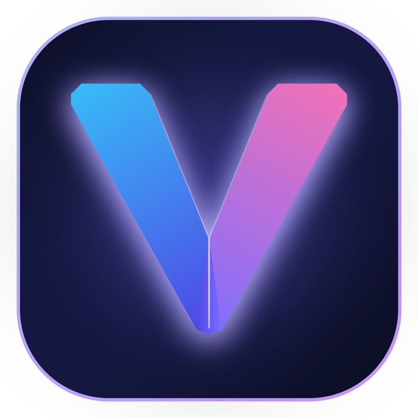

<p align="center">
  
</p>

<h1 align="center">Contributing to Vek</h1>

<p align="center">
  Help make thoughtful, accessible components for Blazor.
  Every clear bug report, useful example, and focused pull request helps.
</p>

<p align="center">
  <a href="#your-first-contribution">Your first contribution</a> |
  <a href="#development-setup">Development setup</a> |
  <a href="#making-a-change">Making a change</a> |
  <a href="#opening-a-pull-request">Opening a pull request</a>
</p>

---

## Start here

Not sure where to begin? Browse [open issues](https://github.com/madiseh/vek/issues), or open one to discuss a bug or idea before investing in a larger change. For help using Vek, start a [discussion](https://github.com/madiseh/vek/discussions).

Please read the [Code of Conduct](CODE_OF_CONDUCT.md). By participating, you agree to follow it.

## Your first contribution

1. Choose an issue or describe the change you want to make. For a new feature or a broad change, discuss the approach first.
2. Fork the repository and clone your fork. The main repository does not accept direct commits.
3. Create a focused branch from `dev`, for example `fix/button-focus-ring` or `feature/tree-view`.
4. Make the smallest complete change. Include tests and documentation when the behavior or public API changes.
5. Run the checks that match your change, then open a pull request targeting `dev`.

If work is still in progress, open the pull request as a draft. Keep one subject per pull request so the change is easy to review.

## Development setup

Vek targets .NET 8, .NET 9, .NET 10, and .NET 11. Install the .NET SDK feature band pinned in [`global.json`](global.json).

The repository contains the component library, docs, tests, and visual test viewer:

| Project | Purpose |
| --- | --- |
| `src/Vek` | Components, utilities, styles, and browser assets |
| `src/Vek.Docs` | Documentation pages and component examples |
| `src/Vek.UnitTests` | bUnit and unit tests |
| `src/Vek.UnitTests.Viewer` | Interactive visual test scenarios |

For a quick component check, run the narrowest relevant test filter:

```bash
dotnet test --project src/Vek.UnitTests/Vek.UnitTests.csproj --no-restore -p:SkipBunCompile=true -- --filter "FullyQualifiedName~ButtonTests"
```

Replace `ButtonTests` with the fixture or test name you changed. The test project builds the component library as part of this command.

For a compile-only check of the library:

```bash
dotnet build src/Vek/Vek.csproj -f net10.0 -p:SkipBunCompile=true
```

The Bun asset step is skipped above because these examples validate C# and Razor changes. For changes to TypeScript, styles, package inputs, or generated browser assets, run the normal scoped build without `SkipBunCompile`.

## Making a change

### Keep the change focused

- Fix the reported behavior without adding unrelated cleanup.
- Prefer a safe, additive API and avoid breaking existing usage.
- Follow the conventions in [Development Rules](docs/governance/development-rules.md) and [Testing Standards](docs/governance/testing-standards.md).
- Use the existing components, CSS variables, and design tokens before introducing new abstractions or values.

### Component behavior and parameters

- Keep component parameters as auto-properties. Put reactions to parameter changes in registered change handlers, not property setters.
- For state-managed parameters, use `[Parameter, ParameterState]`, register them in the constructor with `CreateRegisterScope()`, and update them through `ParameterState<T>.SetValueAsync`.
- Do not assign another component's parameters through `@ref`; pass state declaratively through markup.
- Components that contain behavior need bUnit coverage. Test the state change or user-visible result rather than taking a snapshot of all rendered HTML.
- Interactive controls need an accessible name, visible keyboard focus, and working keyboard behavior. Add right-to-left support when layout depends on direction.

### Documentation and examples

When a component's behavior or public API changes, update its docs page under `src/Vek.Docs/Pages/Components`. Add focused examples in that component's `Examples` folder and reference each example from the page. Keep examples runnable, concise, and ordered from basic usage to advanced cases.

Document public component parameters with XML summaries and the appropriate `Category` attribute. Include defaults or usage constraints when they help consumers make the right choice.

### Tests

- Add or update a test for behavior that could regress.
- Keep tests deterministic; use the repository's fake time and renderer helpers for time-based or asynchronous component behavior.
- Re-query elements after an interaction because a render can replace them.
- Do not add sleeps or blocking waits to make asynchronous tests pass.

See [Testing Standards](docs/governance/testing-standards.md) for bUnit patterns, test naming, parallelization, and accessibility checks.

## Opening a pull request

Before opening your pull request:

- Run the smallest relevant build or test command and include the result in the description.
- Update docs and examples if users will see a behavior or API change.
- Include a screenshot or short recording when the change affects appearance or interaction.
- Format changed C# and Razor files with the repository's formatting rules.
- Check that the diff contains only files needed for this change.

Use a concise title that follows the [commit and pull request title conventions](docs/governance/development-rules.md#6-git-commit-and-pull-request-titles). Link related issues in the description and use `Fixes #<issue>` or `Closes #<issue>` when appropriate.

To update your branch, merge the upstream `dev` branch. Avoid rebasing a contribution branch onto the wrong direction, which can add unrelated commits to the pull request.

## Review and merge

Be ready to explain the user-facing problem and why the proposed change solves it. Review feedback is part of getting the change ready; update the branch and reply to each open point. The project checks builds, tests, and code quality in CI, and maintainers merge contributions after the required checks pass.

Thank you for helping build Vek.
