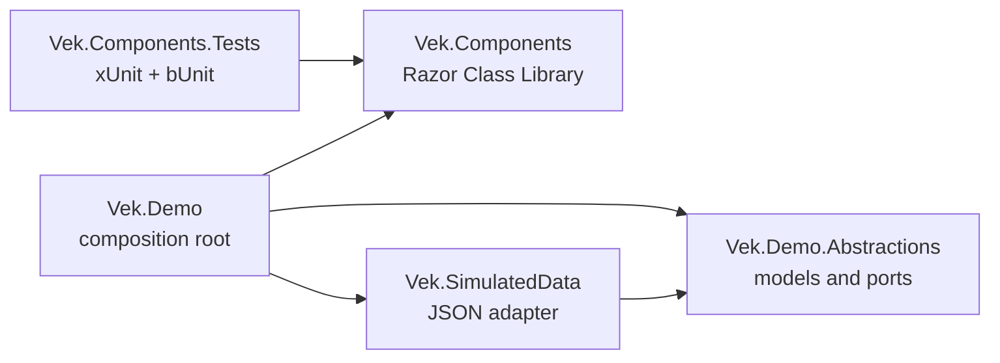

# Architecture

Vek is a .NET 10 Blazor component library with a separate demo host. The solution uses hexagonal boundaries for the demo's data flow: the demo consumes a port, and the JSON-backed sample-data project implements that port.

## Solution Projects

| Project | Responsibility |
| --- | --- |
| `Vek.Components` | NuGet-ready Razor Class Library for reusable Blazor UI components such as buttons, inputs, and data grids. |
| `Vek.Demo.Abstractions` | Demo-facing models and ports, including `DemoProduct` and `IDemoProductProvider`. |
| `Vek.SimulatedData` | JSON sample data and `JsonDemoProductProvider`, the adapter that implements the demo data port. |
| `Vek.Demo` | Blazor Web App and composition root. It registers the JSON adapter and demonstrates the data path. |
| `Vek.Components.Tests` | xUnit and bUnit test project for component behavior. |

## Dependency Direction



`Vek.Components` has no reference to the demo, its models, or its data provider. The demo passes data into components through component parameters and receives user actions through callbacks. A component does not read JSON or call a database/API.

## Sample Data Flow

1. `Vek.Demo` registers `IDemoProductProvider` with `JsonDemoProductProvider`.
2. `JsonDemoProductProvider` reads `products.json` from `Vek.SimulatedData`.
3. The provider returns `DemoProduct` values defined by `Vek.Demo.Abstractions`.
4. The Demo page passes those values to components as it showcases them.

This flow keeps the sample-data adapter replaceable while leaving the component library independent of how a demo obtains data.

## Component Organization

Organize reusable UI components by feature under `Components/`, with each component's Razor markup and isolated CSS together:

```text
Vek.Components/
├── Components/
│   ├── Button/
│   ├── DataGrid/
│   └── ...
├── wwwroot/
│   └── css/
└── _Imports.razor
```

Keep simple components in a `.razor` file. Add a `.razor.cs` code-behind when the component's logic benefits from being separated from its markup. Put shared styles in `wwwroot/css/`.

## Target Framework and Platforms

- All projects target `net10.0` through the root `Directory.Build.props`.
- Solution platform choices are `AnyCPU`, `x86`, and `x64`. The default target is `AnyCPU`; explicitly selected `x86` and `x64` builds set matching platform targets.
- Package only `Vek.Components`. Demo, ports, sample-data, and test projects remain non-packable.
