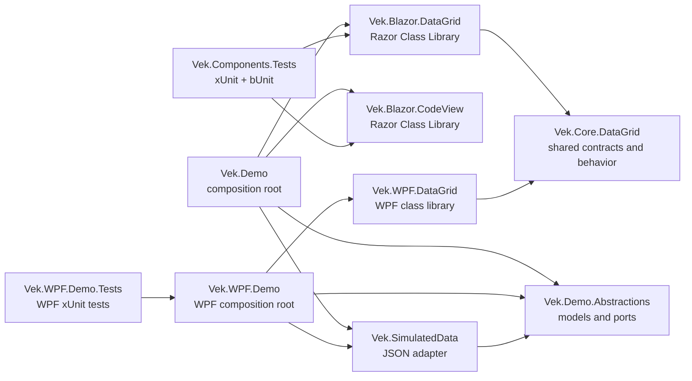

# Architecture

Vek contains reusable .NET 10 Blazor component packages, a reusable WPF DataGrid library, and separate Blazor and WPF demo hosts. Both demos follow the same hexagonal data boundary: they consume a demo-facing port, and the JSON-backed sample-data project implements that port.

## Solution Projects

| Project | Responsibility |
| --- | --- |
| `Vek.Core.DataGrid` | Platform-neutral DataGrid contracts, per-instance state, and shared data operations used by UI adapters. |
| `Vek.Blazor.DataGrid` | NuGet-ready Razor Class Library for the reusable DataGrid feature family. |
| `Vek.Blazor.CodeView` | NuGet-ready Razor Class Library for reusable code-viewer components. |
| `Vek.WPF.DataGrid` | Reusable WPF class library for the native DataGrid control. |
| `Vek.Demo.Abstractions` | Demo-facing models and ports, including `DemoProduct` and `IDemoProductProvider`. |
| `Vek.SimulatedData` | JSON sample data and `JsonDemoProductProvider`, the adapter that implements the demo data port. |
| `Vek.Demo` | Blazor Web App and composition root. It registers the JSON adapter and demonstrates the data path. |
| `Vek.WPF.Demo` | Native WPF application and composition root. It consumes the WPF DataGrid, demo ports, and JSON adapter. |
| `Vek.Components.Tests` | xUnit and bUnit test project for component behavior. |
| `Vek.WPF.Demo.Tests` | Windows-targeted xUnit test project for WPF demo integration and UI behavior. |

## Dependency Direction



The Blazor packages and WPF DataGrid library have no references to either demo host, demo models, or the data provider. Each demo composes the shared provider and passes data into reusable components; components do not read JSON or call a database/API. The Blazor demo uses component parameters and callbacks, while the WPF demo binds the same demo-facing models to native WPF controls.

## Sample Data Flow

1. `Vek.Demo` registers `IDemoProductProvider` with `JsonDemoProductProvider`.
2. `JsonDemoProductProvider` reads `products.json` from `Vek.SimulatedData`.
3. The provider returns `DemoProduct` values defined by `Vek.Demo.Abstractions`.
4. The Demo page passes those values to components as it showcases them.

This flow keeps the sample-data adapter replaceable while leaving the component library independent of how a demo obtains data.

## Component Organization

Organize each independently packaged Blazor component category under `src/Components/Blazor/<PackageProject>/`. Every package project must contain a `Components/` directory; `Directory.Build.targets` enforces this rule during builds. Keep each component's Razor markup and isolated CSS together:

```text
src/Components/Blazor/Vek.Blazor.DataGrid/
├── Components/
│   └── DataGrid/
├── _Imports.razor
└── Vek.Blazor.DataGrid.csproj

src/Components/Blazor/Vek.Blazor.CodeView/
├── Components/
│   └── CodeView/
├── _Imports.razor
└── Vek.Blazor.CodeView.csproj
```

Keep simple components in a `.razor` file. Add a `.razor.cs` code-behind when the component's logic benefits from being separated from its markup. Keep package-wide styles under that package's `wwwroot/` directory.

## Cross-platform component architecture

The [Core Architecture Rule](core-architecture.md) is the canonical, mandatory policy for every Core project and its adapters. Read it before adding shared behavior, designing contracts, or refactoring cross-platform components.

Core owns shared rules, contracts, state, and behavior with zero UI-platform dependencies. UI adapters own native controls, lifecycle, rendering, templates, and platform-specific behavior. Shared methods are implemented once in Core and reused through neutral contracts and extension methods where appropriate, without per-operation forwarding wrappers in every adapter. Optional callbacks are limited to workflows that actually need a varying step; there is no mandatory global UI hook.

The policy includes a [DataGrid target example](core-architecture.md#datagrid-target-example). It describes the agreed architecture for the upcoming refactoring; the current DataGrid implementation is not a compliance reference.

## Target Framework and Platforms

- Cross-platform projects target `net10.0` through the root `Directory.Build.props`; WPF applications, controls, and tests target `net10.0-windows` and use WPF.
- Solution platform choices are `AnyCPU`, `x86`, and `x64`. The default target is `AnyCPU`; explicitly selected `x86` and `x64` builds set matching platform targets.
- Package each reusable component category independently. Demo, ports, sample-data, and test projects remain non-packable.
