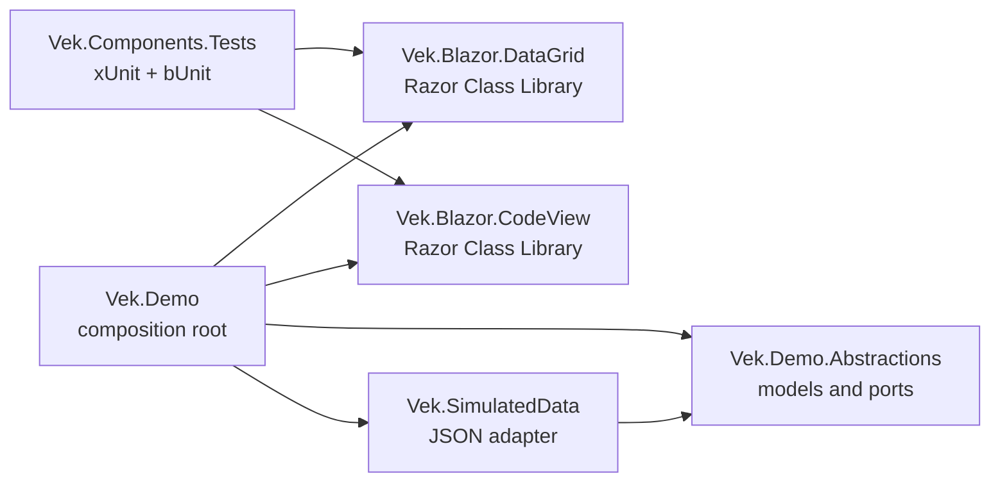

# Architecture

Vek is a set of .NET 10 Blazor component packages with a separate demo host. The solution uses hexagonal boundaries for the demo's data flow: the demo consumes a port, and the JSON-backed sample-data project implements that port.

## Solution Projects

| Project | Responsibility |
| --- | --- |
| `Vek.Blazor.DataGrid` | NuGet-ready Razor Class Library for the reusable DataGrid feature family. |
| `Vek.Blazor.CodeView` | NuGet-ready Razor Class Library for reusable code-viewer components. |
| `Vek.Demo.Abstractions` | Demo-facing models and ports, including `DemoProduct` and `IDemoProductProvider`. |
| `Vek.SimulatedData` | JSON sample data and `JsonDemoProductProvider`, the adapter that implements the demo data port. |
| `Vek.Demo` | Blazor Web App and composition root. It registers the JSON adapter and demonstrates the data path. |
| `Vek.Components.Tests` | xUnit and bUnit test project for component behavior. |

## Dependency Direction



The Blazor packages have no references to the demo, its models, or its data provider. The demo passes data into components through component parameters and receives user actions through callbacks. A component does not read JSON or call a database/API.

## Sample Data Flow

1. `Vek.Demo` registers `IDemoProductProvider` with `JsonDemoProductProvider`.
2. `JsonDemoProductProvider` reads `products.json` from `Vek.SimulatedData`.
3. The provider returns `DemoProduct` values defined by `Vek.Demo.Abstractions`.
4. The Demo page passes those values to components as it showcases them.

This flow keeps the sample-data adapter replaceable while leaving the component library independent of how a demo obtains data.

## Component Organization

Organize each independently packaged Blazor component category under `src/Components/Blazor/<PackageProject>/`. Every package project must contain a `Components/` directory; `Directory.Build.targets` enforces this rule during builds. Keep each component's Razor markup and isolated CSS together:

```text
src/Components/Blazor/Vek.Blazor.DataGrid/
├── Components/
│   └── DataGrid/
├── _Imports.razor
└── Vek.Blazor.DataGrid.csproj

src/Components/Blazor/Vek.Blazor.CodeView/
├── Components/
│   └── CodeView/
├── _Imports.razor
└── Vek.Blazor.CodeView.csproj
```

Keep simple components in a `.razor` file. Add a `.razor.cs` code-behind when the component's logic benefits from being separated from its markup. Keep package-wide styles under that package's `wwwroot/` directory.

## Target Framework and Platforms

- All projects target `net10.0` through the root `Directory.Build.props`.
- Solution platform choices are `AnyCPU`, `x86`, and `x64`. The default target is `AnyCPU`; explicitly selected `x86` and `x64` builds set matching platform targets.
- Package each reusable component category independently. Demo, ports, sample-data, and test projects remain non-packable.
