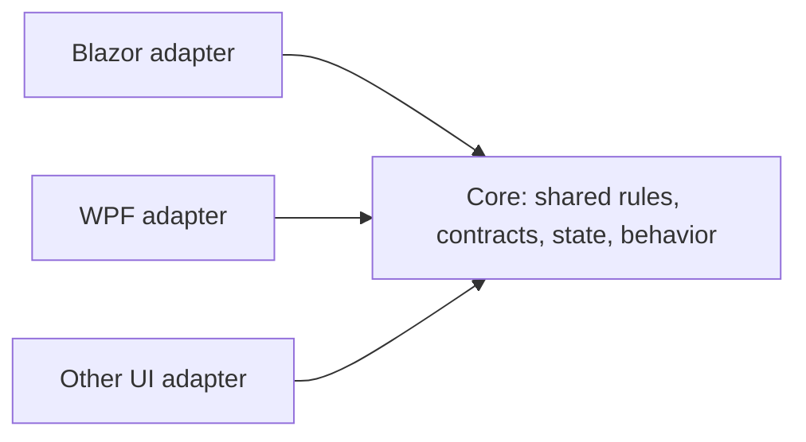

÷# Core Architecture Rule

Status: accepted. This is the canonical architecture policy for **all Core projects**, including every existing and future `Vek.Core.<Category>` project. It also governs the UI adapters that consume them. Refer to this document by the name **Core Architecture Rule** in designs, reviews, and refactoring tasks.

The DataGrid example below describes the agreed target architecture. Recording this rule does not mean the current DataGrid implementation already conforms. Its implementation will be refactored separately against this policy.

## Fundamental rule: complete platform independence

Core contains shared rules, neutral contracts, state, and behavior. Core must have **zero dependency on any UI platform**, including WPF and Blazor. This is an architectural requirement, with no platform-specific exceptions inside Core.

This prohibition covers both technical dependencies and knowledge of platform-specific behavior:

- No references to UI projects, UI packages, UI assemblies, or UI framework references, directly or transitively.
- No platform namespaces, native controls, renderers, event arguments, templates, dispatchers, lifecycle types, or UI APIs in Core source or public contracts.
- No methods, types, properties, parameters, namespaces, or other implementation identifiers named for WPF, Blazor, or another UI platform. Do not introduce members such as `ApplyWpfFilter`, `RefreshBlazor`, or `IsBlazor`.
- No platform detection, platform switches, UI-specific compilation branches, reflection, string-based type lookup, or dynamic dispatch used to reach a UI framework.
- No behavior customized for a particular UI platform, even when hidden behind a neutral name, delegate, interface, `object`, or generic parameter.
- No dependency on Demo, sample-data projects, or the data-access adapters used by hosts.

Renaming platform-specific code does not make it shared logic. A Core operation must be explainable entirely in terms of the component's rules and state, without explaining how a particular UI framework works.

Core targets plain `net10.0`. It must build without UI workloads or platform-specific target frameworks. Build configuration inherited from parent directories must preserve this independence.

## Ownership and dependency direction



The arrows represent source dependencies. Core defines neutral contracts; adapters reference and satisfy those contracts. Core never references an adapter. Calling an adapter-supplied callback through a neutral contract does not reverse this dependency direction.

| Concern | Owner |
| --- | --- |
| Shared state, invariants, algorithms, and state transitions | Core |
| Canonical shared interfaces, models, descriptors, and operation names | Core |
| Shared operation sequencing that has the same meaning across platforms | Core |
| Native control inheritance, component lifecycle, and event translation | UI adapter |
| Rendering, UI refresh, dispatching, focus, native editors, styling, and visual state | UI adapter |
| Concrete native template types and template implementations | UI adapter |
| Provider invocation, persistence, networking, and host configuration | Host or configured infrastructure adapter |

A component supported on only one UI platform does not need a Core project solely for symmetry. A platform-only capability stays in its adapter; adding another adapter must not require inserting platform-specific branches into Core.

## Shared contracts and relationships

Core is the source of truth for shared concepts and their relationships. Adapters use the same shared interface, type, property, operation, and state names. They must not maintain independent versions of the same shared model or algorithm.

For DataGrid, examples include `Items`, `Page`, `PageSize`, `Sorts`, `Filters`, `Groups`, and `SelectedKeys`. Column definitions, query descriptors, group results, and template contexts use the canonical Core contracts wherever their semantics are shared.

UI-specific state may live in an adapter, but it must have a clear presentation or platform purpose. Mapping native state into Core is adapter work. Maintaining a second independent authoritative copy of Core state is prohibited. Any required UI projection must have an explicit synchronization path.

A feature included in a shared contract must be supported by every adapter for that component. Do not satisfy a shared operation with a silent no-op or an unsupported-operation exception. Optional platform behavior must be modeled separately from required shared behavior.

## Implement shared behavior once

Shared behavior must have one implementation in Core. Each adapter must reuse that implementation. Do not copy the algorithm, recreate the workflow, or write one forwarding member per shared operation in every adapter merely to expose the same behavior.

The existing engine pattern is suitable for shared state and algorithms. A neutral host contract can expose that engine. Core extension methods can then provide shared operations directly to every adapter implementing the contract. This gives adapters the common method-call syntax without requiring them to redefine those methods.

Use extension methods when they provide shared operation sequencing or expose the agreed shared surface. Keep algorithms and state transitions in the owning Core module; avoid introducing several forwarding layers around the same operation.

Adapters retain their framework base classes. A shared Core class must not inherit a native UI base class to make cross-platform inheritance possible. In C#, a UI adapter cannot inherit both a Core class and its required native framework class. Implementing a Core interface and using Core extension methods accommodates those native bases.

Extension methods are resolved statically and are not inherited virtual members. An applicable instance method takes precedence over an extension method. During migration, remove or deliberately reconcile old adapter members that would shadow the shared extension. Extension methods also are not instance members for reflection, component parameter discovery, or binding systems; native binding and lifecycle members remain adapter responsibilities.

## UI-specific steps and optional hooks

There is **no mandatory global hook after every Core method**. Pure shared operations execute their rules and update or return neutral state without an automatic rendering callback.

Use a hook, callback, or neutral capability only where a particular workflow genuinely needs a varying step. The adapter supplies the platform-specific implementation only when required. An adapter with no such requirement must not be forced to implement a placeholder method or no-op handler.

The neutral contract describes the meaning of that step. It must not name a platform, expose a native type, or encode assumptions about a platform's renderer. For a continuation callback, Core may define that the callback runs once after a successful operation. The callback implementation owns any native dispatching and UI work. Define ordering, failure, and cancellation behavior when applicable.

For example, an adapter may supply an optional continuation after a filter change. A Blazor caller handling an external update might use it to schedule rendering. Another caller can omit it. Core does not decide whether rendering is necessary and does not inspect which platform supplied the callback. A neutral callback must not become a place to hide a shared filtering algorithm that belongs in Core.

Keep `StateHasChanged`, `InvokeAsync`, dispatcher access, native collection-view refresh, focus, and visual updates in UI projects. Blazor's normal event lifecycle may already schedule rendering; do not add explicit rendering calls unconditionally. WPF may have its own refresh requirements, which must be handled only where actually needed.

An optional continuation is a contract choice for selected operations, not a requirement to add a callback parameter to every Core method. Synchronous shared operations may remain synchronous. Use asynchronous contracts when the workflow actually awaits work.

## Native types through generic contracts

Core may define opaque generic parameters such as `TTemplate`. Adapters supply their concrete native types. Core must not inspect those types, constrain them to UI types, cast them to native types, or branch on their identities.

For DataGrid, use the single generic column contract `IVekDataGridColumn<TItem, TTemplate>` and `VekDataGridTemplate<TContext, TTemplate>` for strongly typed contexts and templates. Adapter code can supply `RenderFragment` or `DataTemplate`; these concrete names belong only in the adapter source. Do not create a second platform-specific column interface that duplicates the Core contract.

Use Core-owned contexts for shared semantics. Introduce an adapter-owned context only for genuinely native concerns. Avoid `object`, `dynamic`, or reflection as an escape route around the generic contract.

## Remote data and side effects

Core constructs neutral request and state descriptors. The host invokes its configured provider with the descriptor and cancellation token, then passes the returned items and total count into Core. Core does not call HTTP clients, databases, or demo providers.

Shared validation and commit contracts can describe neutral outcomes and actions. Concrete persistence, native validation editors, rendering, and thread dispatch remain outside Core. A callback must not pull a platform or infrastructure implementation into the Core dependency graph.

## DataGrid target example

The following sketches illustrate the agreed reuse mechanism. They are a target for the upcoming DataGrid refactoring, not declarations that these APIs already exist. Each top-level type shown together here belongs in its own source file in implementation, with XML documentation on public contracts.

The Core host contract requires only the shared engine. It has no required UI hook:

```csharp
namespace Vek.Core.DataGrid;

public interface IVekDataGridHost<TItem, TTemplate>
{
    VekDataGridEngine<TItem, TTemplate> Engine { get; }
}
```

Two shared operations are implemented once in Core. These examples support an optional continuation for callers that need an additional step:

```csharp
namespace Vek.Core.DataGrid;

public static class VekDataGridHostExtensions
{
    public static async ValueTask ApplyFilterAsync<TItem, TTemplate>(
        this IVekDataGridHost<TItem, TTemplate> grid,
        string columnKey,
        VekDataGridFilterOperator op,
        object? value,
        Func<ValueTask>? afterApplied = null)
    {
        grid.Engine.ApplyFilter(columnKey, op, value);

        if (afterApplied is not null)
            await afterApplied();
    }

    public static async ValueTask RemoveFilterAsync<TItem, TTemplate>(
        this IVekDataGridHost<TItem, TTemplate> grid,
        string columnKey,
        Func<ValueTask>? afterRemoved = null)
    {
        grid.Engine.RemoveFilter(columnKey);

        if (afterRemoved is not null)
            await afterRemoved();
    }
}
```

For these continuations, the state mutation completes before the callback is invoked. If mutation throws, the callback is not invoked. If the callback throws, its exception reaches the caller and the already-completed mutation is not rolled back. Await the returned `ValueTask`; do not discard asynchronous failures. A continuation failure does not justify automatically retrying the state mutation.

The WPF adapter retains its native base and supplies the engine. It has no required hook and no per-operation forwarding methods:

```csharp
// In the WPF adapter project; imports omitted for brevity.
public class VekDataGrid
    : System.Windows.Controls.DataGrid,
      IVekDataGridHost<object, System.Windows.DataTemplate>
{
    public VekDataGridEngine<object, System.Windows.DataTemplate> Engine { get; }
        = new();
}
```

The Blazor adapter supplies its native template type. Its Razor-generated partial class retains the normal component base:

```csharp
// In the Blazor adapter project; imports omitted for brevity.
public partial class VekDataGrid<TItem>
    : IVekDataGridHost<TItem, RenderFragment>
{
    public VekDataGridEngine<TItem, RenderFragment> Engine { get; } = new();

    // An optional local helper for updates that need explicit rendering.
    private ValueTask RenderExternalUpdateAsync() =>
        new(InvokeAsync(StateHasChanged));
}
```

Both adapters can call the shared extension methods without redefining them:

```csharp
await this.ApplyFilterAsync(columnKey, op, value);
await this.RemoveFilterAsync(columnKey);
```

A Blazor external-update handler may supply its local rendering continuation only when that handler requires it:

```csharp
await this.ApplyFilterAsync(
    columnKey, op, value,
    afterApplied: RenderExternalUpdateAsync);
```

A WPF handler can perform its own native refresh where required or supply a suitable neutral continuation. There is no requirement to imitate Blazor rendering. These sketches do not include complete native binding, row refresh, parameter-change callbacks, disposal, or event lifecycle wiring; implementing and testing those integrations remains adapter work.

## Applying the rule to the DataGrid refactoring

The refactoring must inspect the entire DataGrid family: Core, both adapters, public shared models and contexts, and relevant callers and tests. File organization alone does not establish architectural compliance.

1. Inventory shared operations, state, models, and their relationships. Identify the current source of truth and duplicated implementations.
2. Reconcile overlapping adapter models against the canonical Core contracts. Preserve native-only contexts in adapters with an explicit reason.
3. Move platform-neutral algorithms and operation sequencing into Core. Preserve observable behavior and document intentional contract changes.
4. Give adapters a neutral contract for accessing shared behavior. Use shared extension methods where they eliminate repeated forwarding methods.
5. Keep only necessary optional variation points. Remove global refresh assumptions and adapter methods that shadow the intended extension surface.
6. Verify every adapter supports each shared feature, with the same shared names and semantics. Test native integration separately from Core rules.
7. Audit source, project references, resolved dependencies, and inherited build configuration for technical and semantic UI coupling.

## Review and verification requirements

For any Core or adapter change, review the following:

- Can the Core operation be understood and tested without knowing a UI platform?
- Does Core build for plain `net10.0` without UI references or workloads?
- Are UI identifiers, platform types, platform branches, and disguised platform-specific implementations absent from Core?
- Is every shared rule implemented once, with Core as the authoritative state owner?
- Do adapters reuse the shared surface without repeated forwarding members or duplicated algorithms?
- Are generic native values opaque to Core and strongly typed in adapters?
- Are optional callbacks genuinely optional, limited to relevant operations, and documented for ordering and failures?
- Do native lifecycle, dispatching, refresh, binding, and event subscriptions remain in adapters?
- Does every adapter support the features promised by the shared contract?

Tests must protect observable rules and adapter behavior. Follow the repository's testing guidance for functional changes. Test Core with neutral data and neutral template placeholders; Core tests must not require a UI framework. Test each adapter's native integration in its own test environment. For operations with optional continuations, cover omission, ordering after successful mutation, and failure propagation where those are part of the contract.

Text searches and reference inspection are useful evidence, but a clean name search alone does not establish platform independence. Review the meaning of the implementation and the resolved dependency graph as well.
