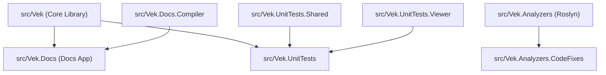

# System Architecture

## Overview

**Vek** is an enterprise-grade, high-performance UI component library designed for .NET developers building modern web applications with Blazor. Written in pure C# with seamless CSS variable integration, Vek is engineered for maximum developer velocity, elegant visual styling, minimal DOM footprint, and robust runtime performance across both **Blazor WebAssembly** and **Blazor Server**.

The library multi-targets `.NET 8.0`, `.NET 9.0`, `.NET 10.0`, and `.NET 11.0`.

---

## 1. Repository Topology & Project Graph

The repository is organized around a unified `src/` layout separating the core component suite, Roslyn analyzers, documentation generation, and testing infrastructure:

```
src/
├── Vek/                               # Core Blazor component library
│   ├── Components/                    # High-level Blazor components (DataGrid, Menu, Dialog, etc.)
│   ├── Styles/                        # SCSS design tokens, themes, and CSS variables
│   ├── TScripts/                      # TypeScript interop helpers, observers, and ripple logic
│   └── Utilities/                     # CssBuilder, StyleBuilder, ParameterState, and helpers
├── Vek.Analyzers/                     # Roslyn analyzers for component parameter validation
├── Vek.Analyzers.CodeFixes/           # Roslyn code fixes for automated migrations
├── Vek.Analyzers.TestComponents/      # Razor test components used by analyzer test suites
├── Vek.Benchmarks/                    # BenchmarkDotNet performance measurement suite
├── Vek.Docs/                          # Main documentation website application
├── Vek.Docs.Compiler/                 # Source generator/compiler extracting code snippets & metadata
├── Vek.Docs.Server/                   # ASP.NET Core Blazor Server host for documentation
├── Vek.Docs.WasmHost/                 # Blazor WebAssembly host for documentation
├── Vek.Examples.Data/                 # Mock datasets and domain entities for examples & tests
├── Vek.UnitTests/                     # Core bUnit component tests (Microsoft.Testing.Platform)
├── Vek.UnitTests.Shared/              # Shared bUnit infrastructure, fixtures, and assertions
├── Vek.UnitTests.Viewer/              # Isolated interactive test viewer for APG accessibility & repros
├── Vek.UnitTests.Analyzers/           # Roslyn analyzer and code-fix verification tests
└── Vek.UnitTests.Docs/                # Generated tests verifying all documentation examples
```

### Project Interdependencies



### NuGet Packaging Architecture
- **Shipped Analyzers**: `Vek.Analyzers.dll` and `Vek.Analyzers.CodeFixes.dll` are packed side-by-side into `analyzers/dotnet/cs` of the primary `Vek` NuGet package. They target Roslyn 4.7.0 (via `<VekRoslynShippedVersion>`) ensuring full compatibility with consuming consumer IDEs and build compilers.
- **Client Assets**: Bun-compiled JavaScript bundles and CSS styles are embedded and packaged as Static Web Assets (`wwwroot/`).

### Release Version Flow
- `src/Directory.Build.props` holds the current stable version in `VersionPrefix` for local builds.
- Release builds use `VersionPrefix` as the package and assembly version, and the publish workflow rejects a release tag that does not match it.
- The public `Vek.Metadata.Version` property reads the generated assembly version. Documentation UI version labels use this property instead of hard-coded version text.

---

## 2. Component Architecture & Rendering Invariants

Vek components are engineered to avoid unnecessary allocations, redundant abstraction layers, and intermediate component instances.

### Root Element Rendering
- **No Internal Wrapper Components**: A library component renders its own root element. Never wrap a library component's root in `VekElement`. `VekElement` is a public utility component for consumers; wrapping internal library components in it doubles component instances per render.
- **Fixed Tag**: If a component's root HTML tag is static (e.g. `<div>`, `<button>`), write it directly in markup.
- **Dynamic Tag (Chosen at Runtime)**: If the HTML tag is dynamic (e.g. `HtmlTag = "section"`), open it from C# using `builder.OpenElement(0, HtmlTag)` and render the inner markup via a private method accepting `RenderTreeBuilder __builder`:
  ```csharp
  // Example: VekBaseButton.OpenRoot pattern
  builder.OpenElement(0, HtmlTag);
  builder.AddMultipleAttributes(1, UserAttributes);
  // Render child content and inner structure
  RenderContent(__builder);
  builder.CloseElement();
  ```
- **Text & Inline Elements**: For dynamic runtime tags whose content is strictly single text or `ChildContent`, emit the element entirely in C# (e.g. `VekText`, `VekStack`).
- **Hardcoded Sequence Numbers**: In hand-written builder code, always hardcode sequence numbers (`0, 1, 2...`) sequentially. Do not calculate sequence numbers using variables or counters.

### Attribute Precedence & UserAttributes
- Attribute order determines precedence: a later attribute with the same name wins in Blazor.
- All components capture unmatched user attributes into `[Parameter(CaptureUnmatchedValues = true)] public Dictionary<string, object>? UserAttributes { get; set; }`.
- Component-computed `class` and `style` values are merged with caller-provided `class` and `style` via `CssBuilder` and `StyleBuilder`.
- Fallback values are used for HTML/ARIA attributes so caller-specified attributes in `UserAttributes` can override them unless strict internal behavior forbids it.

### DataGrid Subsystem & Subfolder Architecture
`VekDataGrid<T>` is a compound enterprise component partitioned into strict functional subdirectories under `src/Vek/Components/DataGrid/`:
- **`Cells/`**: Cell rendering components and cell-level lifecycle helpers (`Cell.cs`, `CellContext.cs`, `HeaderCell.razor`, `FilterHeaderCell.razor`, `FooterCell.razor`, etc.).
- **`Columns/`**: Column definitions and structural bindings (`Column.razor`, `PropertyColumn.cs`, `TemplateColumn.cs`, `HierarchyColumn.razor`, `SelectColumn.razor`).
- **`Filtering/`**: Filtering engines, token evaluation, and filter parameters (`DataGridSearchEngine.cs`, `DataGridSearchTextParseMode.cs`, `Filter.cs`, `FilterDefinition.cs`, `FilterExpressionGenerator.cs`, `DataGridFilterMode.cs`).
- **`Grouping/`**: Row grouping structures, grouping definitions, and footer aggregates (`DataGridGroupRow.razor`, `GroupDefinition.cs`, `AggregateDefinition.cs`).
- **`Models/`**: Event arguments, contexts, validation state, and grid state snapshots (`DataGridSearchBoxContext.cs`, `DataGridCellClickEventArgs.cs`, `GridState.cs`, `IndexBag.cs`).
- **Root Directory**: Reserved exclusively for top-level component orchestrators (`VekDataGrid.razor`, `VekDataGridPager.razor`).

#### Search & Highlighting Pipeline
The search panel provides multi-column full-text evaluation and live highlighting:
- **`DataGridSearchEngine`**: Tokenizes input respecting whitespace and quotes (`"exact phrase"`), evaluating rows against all columns where `column.AllowSearch` is true. Supports `GroupWordsByAnd` (all tokens match across columns), `GroupWordsByOr` (any token matches), and `ExactMatch`.
- **Zero-Component Allocation Highlighting**: Cell text matches are rendered via `RenderCellHighlightedText` using `Splitter.GetFragments` and a cached `NonBacktracking` regex to emit `<mark class="vek-table-cell-highlight">` tags directly to the render tree without instantiating child components per cell.

---

## 3. Reactive State Management: ParameterState Framework

To ensure deterministic state transitions and prevent Blazor re-entrancy issues (`BL0005`), Vek utilizes a dedicated `ParameterState<T>` framework.

### Invariants
1. **Auto-Properties Only**: Component parameters must be pure auto-properties. Never place business logic, state mutations, or change notifications inside parameter getters or setters.
2. **Annotation**: Parameters managed through the framework must be annotated with `[Parameter, ParameterState]`.
3. **Constructor Registration**: Parameters are registered in the component's constructor using `CreateRegisterScope()`:
   ```csharp
   private readonly ParameterState<bool> _expandedState;

   [Parameter, ParameterState]
   public bool Expanded { get; set; }

   [Parameter]
   public EventCallback<bool> ExpandedChanged { get; set; }

   public VekAccordionItem()
   {
       using var registerScope = CreateRegisterScope();
       _expandedState = registerScope.RegisterParameter<bool>(nameof(Expanded))
           .WithParameter(() => Expanded)
           .WithEventCallback(() => ExpandedChanged)
           .WithChangeHandler(OnExpandedChangedAsync);
   }

   private Task OnExpandedChangedAsync(ParameterChangedEventArgs<bool> args)
   {
       // React to parameter changes deterministically
       return Task.CompletedTask;
   }
   ```
4. **Mutations via SetValueAsync**: Never mutate parameter properties directly. Read the current value using `_expandedState.Value` and update it asynchronously via `_expandedState.SetValueAsync(newValue)`.

---

## 4. Design System, Styling, and Design Tokens

Vek's visual language is powered by a modern, CSS-variable-driven design system.

### Core Principles
- **No Hard-Coded Colors**: All colors, backgrounds, borders, shadows, and radii are sourced from CSS custom properties (`var(--vek-palette-...)`).
- **Dynamic Theming**: Light and Dark mode switching is accomplished purely via CSS custom properties and theme attributes without requiring full component re-rendering.
- **Docs Design System & Typography**: The documentation website (`Vek.Docs`) adheres to a high-contrast modern developer aesthetic pairing **Plus Jakarta Sans** (headings, UI) with **JetBrains Mono** (code snippets, CLI prompts, tabular metrics), and an Electric Cobalt (`#2563EB`) / Sky Cyan (`#0EA5E9`) accent palette over Deep Obsidian (`#0B0F17`) dark canvases.
- **Fluent Builders**:
  - `CssBuilder`: Used to fluently assemble CSS classes, conditionally toggle modifier classes, and merge caller-supplied classes.
  - `StyleBuilder`: Used to construct clean inline style strings, CSS custom property overrides, and dimensions.
- **RTL Support**: Components that alter layout based on reading direction observe `[CascadingParameter(Name = "RightToLeft")] public bool RightToLeft { get; set; }`.

---

## 5. TypeScript & Frontend Asset Pipeline

Vek integrates targeted TypeScript helpers for interactions that require direct DOM manipulation, high-frequency events, or browser APIs.

### Toolchain & Architecture
- **Bun via bundotnet.cli**: Frontend asset compilation is powered by Bun (pinned in `src/Directory.Build.props`), managed locally through `bundotnet.cli` in `.config/dotnet-tools.json`.
- **Fast C# Iteration (`-p:SkipBunCompile=true`)**: Normal C#, Razor, test, and doc builds pass `-p:SkipBunCompile=true` to bypass Bun asset bundling. The asset pipeline runs only when `TScripts`, styles, `package.json`, or asset configs are modified.
- **Source Layout**:
  - `src/Vek/TScripts/`: Contains TypeScript sources (`vekHelpers.ts`, `vekRipple.ts`, observers, popover positioning).
  - `entrypoint.ts`: Central export file bundled into `vek.js`.
- **Shipped Bundle Hygiene**: Unit test files (`*.test.ts`) are executed by `bun test` and must **never** be imported into `entrypoint.ts` to prevent test harnesses from leaking into shipped production bundles.
- **Frontend Sources and Generated Minified Assets**: Keep style changes in `src/Vek/Styles/**/*.scss` and script changes in `src/Vek/TScripts/**/*.ts`. Do not edit or include generated `*.min.*` bundles or their source maps from `src/Vek/wwwroot/` in feature PRs. If a local build regenerates these outputs, restore them before committing. Include or update minified bundles and maps only when preparing release artifacts.

---

## 6. Test Viewer & Accessibility (APG) Verification

Vek treats accessibility (ARIA) as a first-class architectural requirement, matching the [W3C ARIA Authoring Practices Guide (APG)](https://www.w3.org/WAI/ARIA/apg/patterns/).

### Architecture
- **Interactive Test Viewer (`src/Vek.UnitTests.Viewer`)**: A dedicated Blazor WASM/Server host that renders components in isolation using minimal chrome (`chrome=none`).
- **Accessibility Tree Verification**:
  - Screen readers render the browser's accessibility tree. Rather than requiring subjective screen-reader runs, automated verification inspects the full AX tree (`Accessibility.getFullAXTree` or browser snapshots).
  - Dynamic states (`aria-expanded`, `aria-activedescendant`, `aria-selected`, `aria-checked`) must transition accurately during keyboard navigation.
  - Highlights and active items must never rely solely on visual CSS classes; they must be mirrored in the accessibility tree.
